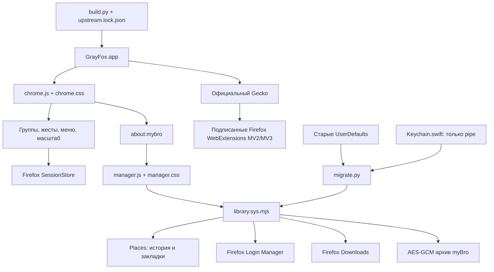

# GrayFox

Текущее публичное название — **GrayFox**. Логотип серой лисы: `Firefox/branding/GrayFox.png`, macOS-иконка: `GrayFox.icns`; метаданные генерации и итоговый промпт: `GrayFox-prompt.json` (встроенный image_gen). Legacy bundle ID, каталог `myBro Firefox`, внутренние `mybro.*` и формат архивов сохранены для совместимости с текущим профилем и прежними данными. При переименовании пути .app нужно также перенести Default нового Install-раздела в profiles.ini/installs.ini на прежний профиль: одного сохранения каталога профилей недостаточно.

Самостоятельный интерфейс myBro на **Gecko / Firefox 160.0.1**, рядом с сохранённым WebKit-приложением.

- Новое приложение: `$GRAYFOX_ROOT/GrayFox.app`.
- Прежняя версия: `$GRAYFOX_ROOT/myBro.app`; её бинарник и Swift-исходники не заменены.
- Дополнительный снимок прежней версии: `.build/legacy/myBro-WebKit-2026-11-19.zip`.
- Профили нового приложения: `~/Library/Application Support/myBro Firefox/`; отдельные от Firefox, WebKit myBro, Vivaldi, Яндекса и Chromium.

## Что именно собрано

Это форк открытого интерфейса Firefox с официальным готовым Gecko. Наш код, стили, внутренние страницы и настройки встраиваются в `browser/omni.ja`; в штатную страницу расширений внутри `omni.ja` добавляются общие навигационные ресурсы myBro. Полная C++-сборка Gecko из исходников здесь не выполнялась. Официальный движок, его исходная ревизия, русская локаль, URL и SHA-256 закреплены в `upstream.lock.json`.

Версия Gecko: **160.0.1**, ревизия `b1145b0710192f716be5f59f5b2dfeed650d5294`. Приложение имеет собственный bundle ID `org.mybro.firefox`, название, значок и каталог профилей. Сборщик также заменяет общие внутренние PNG/SVG-логотипы и графические надписи: нативные диалоги, служебные вкладки и настройки используют GrayFox. PNG-варианты создаются штатным macOS `sips` из GrayFox.png с сохранением исходных размеров ресурсов. В Info.plist и локализованных InfoPlist.strings используется имя GrayFox, чтобы меню macOS не возвращало название Firefox. Строка User-Agent сохраняет стандартный токен Firefox соответствующего Gecko для совместимости сайтов.

## Сборка и проверки

Из корня проекта на macOS:

```sh
rtk proxy python3 Firefox/build.py
rtk proxy python3 Firefox/tests/test_build.py
rtk proxy python3 Firefox/tests/test_runtime.py
rtk proxy python3 Firefox/tests/test_native.py
rtk proxy python3 Firefox/tests/test_tabstrip.py
rtk proxy python3 Firefox/tests/test_menus.py
rtk proxy python3 Firefox/tests/test_migration.py
```

Ряд вкладок и стрелки проверяются отдельно на 53 вкладках: высота 36 px, непрозрачное перекрытие стрелками всей высоты, hit-testing верхнего/нижнего края, плавное скрытие и неизменная ширина viewport. Отдельно проверяются закрытие настоящим крестиком, отсутствие пустого места слева, контекстное закрытие, восстановление и смена группы. Проверяется и значок macOS без переопределения asset-каталогом Firefox.

Для проверки компактного избранного без доступа к пользовательскому профилю запустите `rtk proxy python3 Firefox/tests/bookmarks_preview.py`, откройте выведенный локальный адрес глобальным Playwright и выполните `Firefox/tests/bookmarks_checks.js` через его `browser_run_code_unsafe` с параметром `filename`. Фикстура загружает настоящие `manager.js` и `manager.css`, подменяя только Places синтетическими папками и ссылками. Проверяются сворачивание, поиск, создание, изменение, перенос мышью и отмена удаления, ширины 480–1280 px, внутренний скролл и отсутствие открытых несохранённых вкладок. Эта проверка интерфейса не заменяет нативные испытания хранилища Gecko.

Тот же сервер предоставляет `/history.html?view=history` на выведенном порту. `Firefox/tests/history_checks.js` проверяет компактную историю на 1041 синтетическом посещении: ширины 480–1280 px, строки 32 px, разделители дней, выбор отдельных записей и всех показанных, сохранение выбора при загрузке старых записей, поиск и отбрасывание запоздавшего ответа, удаление посещений одного адреса по отдельности, записи без даты, повтор после частичной ошибки, отмену очистки и передачу периода очистки cookies. Реальная пользовательская история при этих проверках не используется.

Собственный BuildID обновляется при сборке, чтобы Gecko сбрасывал устаревший кеш интерфейса. Сборщик проверяет официальный DMG по закреплённому SHA-256 и подпись Mozilla, затем копирует его, меняет интерфейс и подписывает результат локально. Отказ от замены `myBro.app` проверяется тестом. Для первого запуска сборщика нужен доступ к официальному архиву Mozilla; последующие сборки используют локальный кеш.

Приёмочные проверки запускаются через Marionette на одноразовых профилях. Они проверяют реальный Gecko, внутренние страницы, группировку, восстановление выбранной вкладки и активной внутренней страницы после перезапуска, движение вкладок мышью, нативные закладки и историю, сохранение паролей, автозаполнение на локальной HTTPS-форме, MV2 `webRequestBlocking`, загрузку без диалога, архив и перезапуск. Тестовый сертификат добавляется только во временный профиль; проверки TLS не отключаются. Режим автоматизации включается только тестовым процессом. Красная полоса адреса на тестовых снимках — индикатор автоматизации Firefox, её нет при обычном запуске.

Отдельно проверена обычная установка официального подписанного **uBlock Origin 1.76.4**, Manifest V2; он активен. В пользовательский профиль расширение автоматически не устанавливается.

`Firefox/tests/navigation_checks.js` через глобальный Playwright проверяет общие семь пунктов навигации, переходы, отсутствие экрана заметок, совместимость старого адреса `view=notes` с новой вкладкой, ограничения инкогнито и ширины 480–1600 px. Адрес `/addons.html` на сервере фикстур использует настоящие навигационные JS/CSS с синтетическим содержимым. Наличие панели и штатного списка расширений дополнительно проверяется в работающем `about:addons`; фикстура сама по себе не проверяет Gecko CSP или Firefox WebExtensions. `test_password_navigation.py` проверяет настоящую страницу паролей в headless Gecko: общий заголовок, синтетический логин, команды добавления/изменения/удаления и возврат к настройкам. `test_password_layout.py` проверяет плотность списка, длинные адреса/логины на ширинах 1280/800/480 px и настоящее создание, редактирование и удаление синтетических записей в одноразовом профиле. `test_new_tab_address.py` проверяет пустую строку и немедленный ввод через команду/кнопку новой вкладки, обычные и приватные окна; `test_default_browser_offer.py` проверяет штатные условия предложения без смены системных ассоциаций. `test_auth_popup.py` дополнительно проверяет видимость адреса в окне авторизации. `test_branding.py` проверяет декодирование общих PNG/SVG в Gecko, графические надписи и значок настоящего нативного диалога выбора основного браузера; диалог отклоняется без изменения системного выбора.

## Архитектура



| Файл | Ответственность |
| --- | --- |
| `build.py` | Проверка upstream, чтение оптимизированного Mozilla JAR, встраивание ресурсов, собственный бренд, локальная подпись, сохранение прежней версии. |
| `upstream.lock.json` | Версия, контрольная сумма и происхождение Gecko. |
| `chrome/chrome.js` | Группы с отдельным набором вкладок, реальные жесты перетаскивания, контекстные меню, восстановление, адресная строка, масштаб, загрузки. |
| `chrome/chrome.css` | Размеры и цвета myBro, компактные вкладки, крестики, стрелки поверх полосы, состояния и анимации. |
| `chrome/pages.sys.mjs` | Регистрация доверенной внутренней страницы `about:mybro`. |
| `chrome/manager.*` | Новая вкладка, история, дерево закладок, загрузки, шесть разделов настроек и профиль. |
| `chrome/navigation.*`, `chrome/addons-navigation.js`, `chrome/addons-layout.css` | Единые названия, порядок, действия и оформление навигации на внутренних страницах, в штатном `about:addons` и над `about:logins`. Для защищённой страницы паролей панель находится в chrome-окне; доступ к паролям остаётся штатным. |
| `chrome/library.sys.mjs` | Нативные хранилища Firefox, очистка, перенос данных, проверка адресов и шифрованный архив. |
| `migrate.py` | Локальный перенос прежнего myBro и регистрация отдельного профиля; повторный импорт в непустой профиль запрещён. |
| `branding/GrayFox.png`, `branding/GrayFox.icns`, `chrome/branding/wordmark.svg` | Публичные логотип и название GrayFox; прежние Resources/AppIcon.* относятся к сохранённой WebKit-версии. |
| `chrome/passwords/` | Компактное оформление нативного `about:logins` и его Shadow DOM: список 40 px, карточка записи, поля/кнопки, короткие даты и адаптация узких окон. Сборщик дописывает CSS к штатным стилям; CSP, скрипты и OS-auth не меняются. |
| `Keychain.swift` | Чтение только прежнего хранилища myBro через macOS Security; пароли передаются импортёру по pipe. |
| `tests/` | Сборочные проверки и испытания настоящего браузера на временных профилях. |

При запуске нового окна стартовая страница myBro подставляется только в обычное пустое окно. Popup-окна без штатной панели инструментов и окна с content-opener не перенаправляются: окно авторизации может оставаться `about:blank`, пока сайт готовит переход. `tests/test_auth_popup.py` проверяет это на настоящем headless Gecko с локальной страницей, без Google и реальных учётных записей: обычное новое окно, popup входа и окно входа с полной панелью.

## Перенесённые функции

| Область | Реализация |
| --- | --- |
| Вкладки | Горизонтальная полоса, сужение до компактного размера, светлая выбранная вкладка и наведение; значок остаётся видимым и неподвижным при наведении, крестик активной вкладки расположен поверх, движение настоящего элемента и раздвижение соседей. |
| Группы | Показ только выбранной группы, новая вкладка в ней, изменение имени/цвета/порядка, удаление без удаления страниц, изменение ширины зоны групп вертикальным разделителем. В macOS зазор после системных кнопок сокращён с 40 до 12 px; в fullscreen он скрыт штатным правилом. |
| Переполнение | Стрелки поверх полосы без выделенного места; скрытие у краёв с анимацией. |
| Восстановление | SessionStore сохраняет группу и позицию; `⌘⇧T` восстанавливает вкладку с короткой анимацией. |
| Адресная строка | Штатное автодополнение Firefox по посещениям, закладкам, открытым вкладкам и поиску; значок Google/DuckDuckGo/Bing. |
| История | Отдельная вкладка, компактные строки 32 px с ограничением длинных названий/адресов и внутренней прокруткой; разделители дней, поиск, галочки отдельных посещений, выбор всех показанных и счётчик выбранного, удаление выбранных записей, загрузка более старых с сохранением выбора, очистка истории/cookies за период. |
| Необычная история | Адреса, не принимаемые нативной историей Gecko, посещения с совпавшей миллисекундой и записи без даты сохраняются в локальном `mybro-history-overflow.json`; доступны в истории myBro, удалении и архиве. Штатная страница истории Firefox и его подсказки не используют этот дополнительный файл. |
| Закладки | Штатная звёздочка с выбором папки; компактное сворачиваемое дерево сохранённых папок (строки 28 px), список избранного (32 px), поиск, перенос/переименование/удаление; открытие в отдельном окне из панели звёздочки. Длинные названия и адреса сокращаются с полной подсказкой, панели прокручиваются внутри окна. Открытые несохранённые вкладки здесь не показываются. |
| Загрузки | Штатная загрузка в Downloads без вопроса, если пользователь не включил запрос папки; всплывающий список, круговой прогресс, полная страница по месяцам/дням, открытие/показ в Finder/отмена. |
| Пароли | Отдельный пункт «Пароли» в общей навигации открывает штатный `about:logins`: список всех сохранённых записей, поиск, добавление, изменение, удаление, копирование, показ и импорт/экспорт. Общая панель с выбранным пунктом остаётся над менеджером; защита и подтверждения Firefox сохранены. Есть добавочный импорт CSV Vivaldi/Chromium без повторного переноса сессии. Для формы EasyDocs с нестандартным `type="login"` DOM-адаптер задаёт стандартные `type="text"` и `autocomplete="username"`; сами пароли заполняет Gecko. |
| Видео 9GAG | Перенесён обработчик из пользовательского Vivaldi site fixes 1.2.0: клик по видео переключает штатную кнопку звука и оставляет ленту открытой. Ограничен HTTPS 9gag.com/www.9gag.com, без дополнительных прав расширений; кнопки, модифицированные клики и нативные controls остаются штатными. |
| Расширения | Штатные Firefox WebExtensions, включая MV2 с блокирующим webRequest; страница `about:addons` с центрированным блоком бокового меню и содержимого, общей панелью «Мой профиль / Закладки / Загрузки / История / Пароли / Расширения / Настройки». |
| Профили | Штатный сервис Firefox, собственный реестр профилей, `about:profiles`; выбор профиля сохраняется штатным механизмом запуска. |
| Инкогнито | ⌘⇧N открывает нативное приватное окно; это сочетание больше не восстанавливает закрытое обычное окно. Обычные группы не читаются и не показываются, создание групп и перенос в них отсутствуют; приватные вкладки не получают общий ID группы. Постоянная фиолетовая метка с маской и текстом «Инкогнито» расположена рядом с адресной строкой; поиск DuckDuckGo, обычный поиск Google; сохранение приватной истории и сессии контролирует Gecko. |
| Настройки | Общие, интерфейс, инструменты, сайты, системные, специальные возможности; тема, новая вкладка, поиск, пароли, загрузки, PDF, разрешения, шрифты и масштаб. Дополнительные параметры доступны в штатных настройках Firefox. |
| Главное меню | Кнопка с тремя точками открывает только штатную панель Firefox; дополнительное меню myBro удалено. Контекстные меню вкладок и групп сохранены. |
| Запуск и новая вкладка | Включено штатное предложение выбрать myBro основным браузером с проверкой текущего системного выбора и возможностью отключить напоминание. На стартовой странице адресная строка пустая и готова к вводу; внутренние адреса других разделов и адреса сайтов остаются видимыми. Кнопка «+» создаёт одну вкладку. |
| Прочее | Печать, поиск на странице, нативный снимок страницы, мини-индикатор масштаба с шагом 10 пунктов. Экран заметок удалён; старые адреса открывают новую вкладку, сохранённый ранее текст не стирается. |

## Перенос прежнего профиля

Проверка источника без переноса:

```sh
rtk proxy python3 Firefox/migrate.py --inspect
```

Перенос в **новую пустую** папку; исходное приложение не меняется:

```sh
rtk proxy python3 Firefox/migrate.py --profile "/абсолютный/путь/к/новому/профилю" --passwords
```

Если Связка ключей временно недоступна, остальные данные можно перенести без `--passwords`, а после разблокировки Mac добавить только пароли:

```sh
rtk proxy python3 Firefox/migrate.py --profile "/путь/к/перенесённому/профилю" --passwords-only
```

Не повторяйте полный перенос в частично заполненную папку: создайте новую. Инструмент защищает существующий профиль от замены. Пароли не выводятся в терминал и не сохраняются в промежуточном CSV/JSON. Источник в Связке ключей не изменяется.

Добавить пароли из уже экспортированного CSV в перенесённый профиль при закрытом браузере:

```sh
rtk proxy python3 Firefox/migrate.py --profile "/путь/к/перенесённому/профилю" --passwords-csv "/путь/к/паролям.csv"
```

Колонки `url`, `username`, `password` обязательны; CSV с BOM, запятыми, кавычками и переносами строк поддерживается. Записи внутренних схем вроде `vivaldi://` подсчитываются как пропущенные. Существующие логины не перезаписываются. `--inspect` проверяет CSV и показывает только количество. Исходный CSV остаётся на месте, дополнительный открытый файл с паролями не создаётся.

Переносятся вкладки и группы, выбранная вкладка, закрепление, закрытые вкладки, история с исходными датами, папки/закладки, поддерживаемые настройки, метаданные загрузок и доступные пароли. Активные скачивания не продолжаются автоматически.

Внутренняя страница профиля поддерживает зашифрованный переносимый `.mybroprofile`: вкладки активного окна и группы, история, дерево закладок, пароли и настройки myBro. Формат `MYBROPF1`: PBKDF2-HMAC-SHA256 600000, AES-256-GCM, случайные соль и nonce, парольная фраза от 12 символов, до 128 МиБ. Поддерживается импорт архива старого myBro. Это переносимый архив данных, а не побайтовая копия всего Firefox-профиля.

## Ограничения поставки

- Расширения Chromium/CRX автоматически не превращаются в Firefox-расширения. Нужны версии из Mozilla Add-ons; совместимость каждого расширения проверяется отдельно.
- Cookies, действующие входы и веб-хранилища прежнего WebKit не перенесены. На сайтах может понадобиться вход заново.
- Firefox-архив не включает cookies, установленные расширения и их настройки, сертификаты и сами скачанные файлы. Для полной побайтовой резервной копии нужно копировать весь каталог профиля при закрытом браузере.
- Подпись локальная ad hoc, публичная notarization не выполнена. Специальное Apple entitlement Mozilla для платформенных passkeys не переносится в локальный форк; входы с Touch ID/passkeys требуют отдельной проверки и полноценной подписи приложения.
- Автообновление Mozilla отключено, чтобы не потерять оболочку myBro. Обновления Gecko нужно выпускать через сборщик с новой проверенной версией и контрольной суммой.
- В полноэкранном режиме используются штатные выезжающие кнопки macOS. Дублирующих кнопок myBro в строке вкладок нет, группы начинаются у левого края. Обычное окно сохраняет системные кнопки; оба режима проверены в работающем приложении через Computer Use.
- Нагрузочные сравнения памяти/скорости, DRM, все Google-сервисы после входа и все сторонние расширения не проверены. Наличие актуального Gecko и стандартного User-Agent не является доказательством совместимости каждого сайта.
- Яндекс-сервисы, Алиса и корневой сертификат Минцифры не добавляются. Системное хранилище сертификатов macOS не изменяется.
- `crapper`, `dryer`, `mutator` отсутствуют в окружении; эти проверки не выполнялись.

Открытые исходники и лицензирование: [THIRD_PARTY.md](THIRD_PARTY.md).

Автоматическое всплывающее предложение перевода отключено по умолчанию (`browser.translations.automaticallyPopup=false`). Определение языка, значок перевода и ручное открытие штатной панели сохранены; настройку можно вернуть в меню переводчика.
