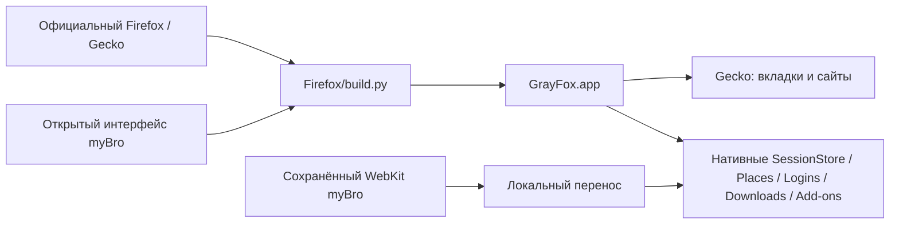
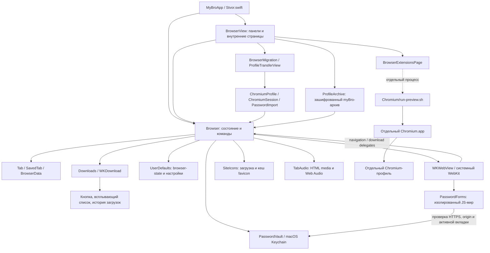

# myBro: карта проекта

Снимок исходников: **19 ноября 2026 года**. Рабочий каталог: `$GRAYFOX_ROOT`.

Эта карта составлена по текущему коду, локальному графу и выполненным в этой переписке работам. Наличие функции в исходниках, наличие теста и успешная проверка на реальном сайте — разные уровни подтверждения. Пользовательские пароли, адреса посещённых страниц и содержимое профилей в документацию не включены.

## Навигация

- [Матрица функций и ограничений](docs/FEATURES.md).
- [Все настройки, хранение и сочетания клавиш](docs/SETTINGS.md).
- [Выполненные работы, проверки и открытые вопросы](docs/WORK_LOG.md).
- [Интерактивный граф](graphify-out/graph.html), [данные графа](graphify-out/graph.json), [отчёт Graphify](graphify-out/GRAPH_REPORT.md).
- [Сборка основного приложения](build.sh), [отдельный Chromium](Chromium/README.md).

## 1. Что представляет собой проект сейчас

| Часть | Фактическое состояние |
| --- | --- |
| Сохранённый `myBro.app` | Нативный интерфейс SwiftUI/AppKit, страницы через системный WebKit / `WKWebView`. |
| Отдельный Chromium | Предварительная сборка ungoogled-chromium; собственный профиль, штатные расширения и менеджер паролей. |
| Связь двух частей | Страница расширений запускает отдельное приложение Chromium скриптом. Это не переключение движка вкладки myBro. |
| Новое `GrayFox.app` | Форк открытого интерфейса на официальном Gecko 160.0.1; отдельный профиль, штатные пароли, Firefox MV2/MV3 и сервисы браузера. [Полная карта новой части](Firefox/README.md). |
| Платформа | macOS 14+, сборка под архитектуру текущего Mac. Chromium-скрипт ориентирован на arm64. |
| Метаданные | Название myBro, версия 0.2.0 / build 2, bundle ID `org.openstvor.browser`. |
| Лицензия | [MIT](LICENSE); сторонние Chromium и расширения сохраняют собственные лицензии. |
| Git | В корне на дату снимка нет Git-репозитория. История ниже не является журналом коммитов. |
| Поставка | Локальная подпись ad hoc. Публикация, notarization и механизм автообновления не реализованы. |

Размер `myBro.app` не включает системный WebKit. Сравнительных измерений памяти и скорости с другими браузерами нет.

## 2. Новая основа Firefox

Сборщик и пин upstream: `Firefox/build.py`, `Firefox/upstream.lock.json`. Оболочка: `Firefox/chrome/chrome.js` и `chrome.css`. Внутренние страницы: `pages.sys.mjs`, `manager.*`; общая навигация, включая штатный `about:addons`: `navigation.*`, `addons-navigation.js`; адаптеры нативных хранилищ и архив: `library.sys.mjs`. Перенос прежнего профиля: `Firefox/migrate.py`, защищённый pipe из Keychain: `Firefox/Keychain.swift`. Приёмочные проверки: `Firefox/tests/`.

`pages.sys.mjs` также регистрирует два изолированных по сайтам DOM-обработчика Gecko: `MyBro9GagChild.sys.mjs` переносит переключение звука из локального расширения Vivaldi; `MyBroLoginFieldsChild.sys.mjs` исправляет нестандартный тип поля логина EasyDocs для нативного менеджера паролей. Оба работают только в web-процессах, не имеют parent-обработчиков сообщений и явно объявлены `safeForUntrustedWebProcess` для Gecko 160. Проверка настоящих actors: `Firefox/tests/test_content_actors.py` (headless, отдельный профиль, синтетическая локальная страница). Приватные окна не используют общий список групп; `migrate.py --passwords-csv` добавляет сохранённые пароли без повторного импорта вкладок.



Граф проекта включает наш код двух реализаций и Chromium-скрипты. C++ движка Gecko внутрь локального AST-графа не извлекался. Старое приложение не заменяется при сборке нового. История, не принимаемая нативным API Gecko, сохраняется в дополнительном локальном хранилище и доступна через историю myBro.

## 3. Архитектура сохранённой WebKit-версии



Стрелки на этой схеме описывают проверенные по исходникам зависимости уровня модулей. Детальный Graphify-граф содержит также автоматически выведенные связи и не заменяет эту схему.

## 3. Реестр исходников

### Оболочка, вкладки и окно

| Файл | Ответственность |
| --- | --- |
| [Sources/Stvor.swift](Sources/Stvor.swift) | `@main MyBroApp`, сцены основного окна / инкогнито / избранного, `BrowserView`, меню, вкладки, группы, адресная строка, встроенная история, команды, поиск на странице, печать и снимки. Самый большой UI-файл. |
| [Sources/Browser.swift](Sources/Browser.swift) | Модели `SavedTab`, `Tab`, `BrowserData`; `Browser`; выбор и порядок вкладок, группы, сохранение, история, масштаб, закладки, импорт, делегаты WebKit. |
| [Sources/TabStripMetrics.swift](Sources/TabStripMetrics.swift) | Ширина вкладок и ленты, переполнение, края и постраничная прокрутка, пределы ширины групп. |
| [Sources/TabStripReorder.swift](Sources/TabStripReorder.swift) | Расчёт перестановок, смещений соседей и автопрокрутки при перетаскивании. |
| [Sources/TabStripDragItem.swift](Sources/TabStripDragItem.swift) | Смещение настоящей строки вкладки / группы и измерение её исходной области. |
| [Sources/TabStripWindowInteraction.swift](Sources/TabStripWindowInteraction.swift) | Запрет перетаскивания всего окна при взаимодействии с вкладками и группами. |
| [Sources/TabRestoreAppearance.swift](Sources/TabRestoreAppearance.swift) | Локальная анимация восстановленной вкладки. |
| [Sources/BrowserTabKeyHandler.swift](Sources/BrowserTabKeyHandler.swift) | Обработка Control+Tab и изменения масштаба в пределах своего окна. |
| [Sources/FullscreenWindowButtons.swift](Sources/FullscreenWindowButtons.swift) | Нативные системные кнопки в полноэкранном режиме; зелёная выходит из него. |
| [Sources/TabAudio.swift](Sources/TabAudio.swift) | Отключение HTML-аудио/видео, обработка фреймов; приостановка Web Audio. |

### Адрес, история, избранное и настройки

| Файл | Ответственность |
| --- | --- |
| [Sources/Address.swift](Sources/Address.swift) | `Page`, поисковики, URL / запрос, локальные и сетевые подсказки, сопоставление русской раскладки. |
| [Sources/BrowserAddressField.swift](Sources/BrowserAddressField.swift) | Нативное поле `NSTextField`, управление фокусом, вводом и командами; размеры адресной панели. |
| [Sources/AddressSuggestionList.swift](Sources/AddressSuggestionList.swift) | Выпадающий список подсказок и значки поисковых систем. |
| [Sources/BrowserLibrary.swift](Sources/BrowserLibrary.swift) | `HistoryVisit`, `BookmarkFolder`, `GroupTint`, периоды очистки `ClearPeriod`. |
| [Sources/Bookmarks.swift](Sources/Bookmarks.swift) | Панель закладок, редактор закладки, отдельный менеджер с деревом папок. |
| [Sources/BrowserPreferences.swift](Sources/BrowserPreferences.swift) | Ключи и допустимые значения настроек, темы, режимы панели закладок. |
| [Sources/BrowserSettingsPage.swift](Sources/BrowserSettingsPage.swift) | Шесть разделов настроек, поиск по ним, действия очистки и сброса, выбор основного браузера. |
| [Sources/SiteIcons.swift](Sources/SiteIcons.swift) | Общий по origin адрес значка, fallback `/favicon.ico`, дедупликация загрузок, ограничения размера, кеш и повторные попытки. |

### Загрузки, пароли и перенос

| Файл | Ответственность |
| --- | --- |
| [Sources/Downloads.swift](Sources/Downloads.swift) | `DownloadItem`, прогресс и состояния, выбор назначения, уникальные имена, отмена, сохранение истории. |
| [Sources/DownloadsButton.swift](Sources/DownloadsButton.swift) | Стрелка с круговым прогрессом, якорь панели, всплывающие последние девять загрузок. |
| [Sources/DownloadHistoryPage.swift](Sources/DownloadHistoryPage.swift) | Полная история: поиск, месяцы и дни, открыть файл, показать в Finder, убрать запись, отменить. |
| [Sources/PasswordVault.swift](Sources/PasswordVault.swift) | Origin и учётная запись, совпадение логина, чтение/запись в Keychain. |
| [Sources/PasswordForms.swift](Sources/PasswordForms.swift) | Обнаружение форм, username-first, динамические поля, выбор учётной записи, сохранение и автозаполнение. |
| [Sources/ProfileViews.swift](Sources/ProfileViews.swift) | UI менеджера паролей и мастера импорта/экспорта. |
| [Sources/ProfileArchive.swift](Sources/ProfileArchive.swift) | Формат `.mybroprofile`, AES-GCM, PBKDF2, CSV паролей, проверки размеров и ошибок. |
| [Sources/ProfileMerge.swift](Sources/ProfileMerge.swift) | Объединение профилей и устранение повторов. |
| [Sources/BrowserMigration.swift](Sources/BrowserMigration.swift) | План импорта из папки, файла вкладок и CSV; диагностика пропусков, счётчики. |
| [Sources/ChromiumProfile.swift](Sources/ChromiumProfile.swift) | Чтение Chromium Bookmarks / History / Preferences / сессий; Vivaldi и Яндекс. |
| [Sources/ChromiumSession.swift](Sources/ChromiumSession.swift) | Разбор поддерживаемых SNSS-сессий, групп и рабочих пространств. |
| [Sources/BrowserExtensionsPage.swift](Sources/BrowserExtensionsPage.swift) | Запуск менеджера расширений отдельного Chromium. |

Реестр содержит все 30 Swift-файлов каталога `Sources` на дату снимка.

## 4. Остальная структура

```text
myBro/
  Sources/                  основной нативный браузер
  Tests/                    11 Swift-тестов, 2 JS-набора, 2 Python-фикстуры
  Resources/                AppIcon.png, AppIcon.icns, значки поисковиков
  Tools/TabExport/           MV3-расширение экспорта вкладок исходного браузера
  Chromium/
    prepare.sh              закреплённый checkout и применение патчей
    build-native.sh         сборка исходников Chromium и проверка подписи
    run-preview.sh          запуск отдельной сборки с отдельным профилем
    group-picker.patch      переключатель групп; включает нативный тест
    group-ribbon.patch      изменения поведения интерфейса групп
    app-name.patch          имя приложения в метаданных macOS
  myBro.app/                готовое основное приложение
  .build/                   сборочные кеши, Chromium, toolchain и тестовые материалы
  graphify-out/             интерактивный граф, JSON и технический отчёт
  docs/                     матрица функций, настройки и журнал работ
  build.sh                  сборка SwiftUI-приложения
  Info.plist                метаданные приложения и обработчики типов / URL
  LICENSE                   лицензия собственного кода
  PROJECT_MAP.md            эта карта
```

`.build/` и пользовательские профили не являются каталогами документации. Их содержимое не копировалось в карту.

## 5. Основные потоки

**Открытие страницы.** Ввод → `Address.resolve` → `Browser.open` → ленивый `prepare` → `WKWebView.load` → `didCommit` / `didFinish` → адрес, заголовок, история и сохранение состояния. Внутренние страницы отображаются SwiftUI через `InternalPage`, а не загружаются как самостоятельный web UI.

**Вкладки и группы.** `visibleTabs` фильтрует активную группу и ставит закреплённые вкладки первыми. Идентичность вкладки — UUID времени выполнения; `SavedTab` хранит её долговременные свойства. Выбранная вкладка каждой группы восстанавливается. Перетаскивание сначала меняет визуальный порядок, затем фиксирует его в модели.

**Восстановление.** Закрытая вкладка сохраняет группу, индекс и время. `reopen()` извлекает последнюю запись, возвращает её на место и задаёт `reopenedTabID`. Анимация применяется к этой строке. Стек закрытых ограничен 25 записями.

**Пароли.** JS формы → native bridge → проверка активного верхнего HTTPS-фрейма, точного origin и порта → Keychain → выбор/подстановка. Передача сохранённого пароля стороннему origin не разрешается.

**Импорт.** Выбор источников → `BrowserMigration.inspect` → просмотр количеств и пропусков → `Browser.importProfile` → merge данных, Keychain и истории загрузок. Это объединение поддерживаемых данных, а не побайтовый перенос профиля.

**Загрузка.** Решение делегата WebKit → `WKDownload` → резервирование имени → папка назначения → прогресс в кнопке → завершение / ошибка → история. Повторное скачивание не перезаписывает одноимённый файл.

## 6. Сборка и проверка

```sh
cd $GRAYFOX_ROOT
rtk proxy sh build.sh
rtk proxy codesign --verify --deep --strict $GRAYFOX_ROOT/myBro.app
rtk proxy open -a $GRAYFOX_ROOT/myBro.app
```

Сценарий компилирует `Sources/*.swift` с оптимизацией `-O`, копирует ресурсы и подписывает приложение ad hoc. Зависимости нативной части — системные SwiftUI, AppKit, WebKit, Foundation, Security, CryptoKit, CommonCrypto, ImageIO, UniformTypeIdentifiers, Carbon и SQLite. Отдельного Swift Package / npm-проекта для основной оболочки нет.

### Карта тестов

| Проверка | Что покрывает |
| --- | --- |
| `Tests/AddressTests.swift` | URL, запросы, поисковики, локальные/сетевые подсказки. |
| `Tests/BrowserTests.swift` | Группы, перестановки, приватные сессии; загрузки и cookies с локальной фикстурой. |
| `Tests/BrowserSettingsTests.swift` | Восстановление сессии, масштаб, шрифт, папка загрузок, сброс. |
| `Tests/BrowserZoomTests.swift` | Шаг 10 пунктов, отдельный масштаб вкладок, пределы и сброс. |
| `Tests/ProfileTests.swift` | CSV, origin, Chromium-профили, архив, merge; опционально `--webkit` для тестового Keychain и форм. |
| `Tests/SiteIconTests.swift` | Кандидаты значков, размеры, кеш и загрузка с локальной фикстурой. |
| `Tests/TabStripTests.swift` | Постепенная ширина, переполнение, края, paging и ширина групп. |
| `Tests/TabStripReorderTests.swift` | Перестановки, смещения соседей и drag-поведение. |
| `Tests/ReopenTests.swift` | Место и группа восстановления, пустые вкладки, LIFO и сохранение. |
| `Tests/TabActionsTests.swift` | Действия меню, границы группы и pinned, duplicate, reload, mute во фреймах и после перезагрузки. |
| `Tests/WindowControlsTests.swift` | Системные кнопки и выход из fullscreen. |
| `Tests/password-forms.cjs` | Playwright-сценарии обычных, динамических, username-first и небезопасных форм. |
| `Tests/chromium-smoke.cjs` | Отдельный Chromium: MV2/MV3, uBlock и изоляция профилей. |
| `Tests/download-fixture.py`, `Tests/favicon-fixture.py` | Локальные HTTP-фикстуры без реальных учётных данных. |

Пример небольшого набора:

```sh
rtk proxy swiftc Sources/TabStripMetrics.swift Tests/TabStripTests.swift   -module-cache-path .build/modules -o /private/tmp/mybro-tab-strip-tests
rtk proxy /private/tmp/mybro-tab-strip-tests
```

Для интеграционного Swift-теста нужен весь `Sources`, кроме `Stvor.swift` с `@main`, плюс один тестовый файл. Проверки UI требуют macOS-сессии; Keychain-тесты используют тестовые сервисы. Наличие теста здесь не означает, что весь набор заново запущен при подготовке карты.

## 7. Граф: как читать и обновлять

- 1307 узлов, 2987 связей; сообщества пересчитываются по текущему графу.
- 2629 связей помечены `EXTRACTED`, 358 — `INFERRED`.
- В конечном JSON нет связей с отсутствующими концами. Есть 19 self-loop-связей; это автоматический результат анализа, не доказательство рекурсии или ошибки браузера.
- Повторяющиеся внешние имена вроде `Foundation` / `SwiftUI` могут объединяться экстрактором. Патчи Chromium, динамическое поведение JS и AppKit отражены неполно.
- HTML использует vis-network с внешнего CDN `unpkg.com`; для первоначальной загрузки визуализации нужен доступ к нему. JSON и Markdown доступны без сети.

```sh
rtk proxy graphify extract $GRAYFOX_ROOT --code-only
rtk proxy graphify cluster-only $GRAYFOX_ROOT
rtk proxy graphify query 'Browser PasswordForms PasswordVault' --budget 1600
```

Извлечение выполнено локально, только по коду, без LLM-провайдера. Семантическая индексация личных документов, профилей и паролей не выполнялась.

## 8. Что требует дальнейшего решения

Подробности: [матрица функций](docs/FEATURES.md#ограничения-и-нерешённые-вопросы) и [журнал работ](docs/WORK_LOG.md#открытые-вопросы). Новая основа выбрана: myBro Firefox объединяет интерфейс и полноценные браузерные сервисы на Gecko. Разделы о Swift/WebKit и Chromium выше остаются картой сохранённых реализаций; актуальная новая часть описана отдельно в `Firefox/README.md`.
