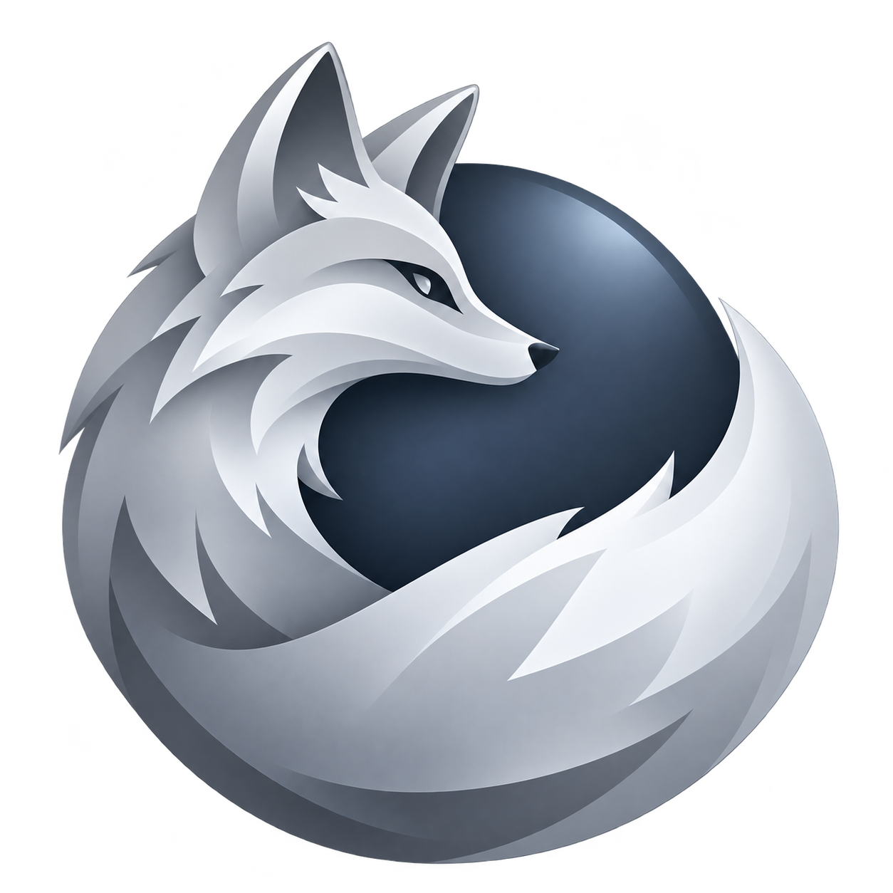

<p align="center"></p>

# GrayFox

Компактный браузер для macOS на Gecko с горизонтальными группами вкладок и минималистичным интерфейсом. GrayFox — самостоятельная оболочка на официальной поставке Firefox; проект не связан с Mozilla.

[Скачать релиз](https://github.com/GameCatMate/GrayFox/releases) · [Устройство проекта](PROJECT_MAP.md) · [Функции](docs/FEATURES.md) · [Настройки](docs/SETTINGS.md) · [Лицензии](Firefox/THIRD_PARTY.md)

## Возможности

- Группы вкладок со счётчиками, перетаскиванием, изменяемой шириной и восстановлением закрытых вкладок.
- Компактные закладки, история с выборочным удалением, загрузки и менеджер сохранённых паролей.
- Расширения Firefox, включая Manifest V2; отдельное окно инкогнито с заметным индикатором.
- Импорт вкладок, групп, закладок и истории; пароли переносятся из локального CSV или поддерживаемого старого профиля.
- Масштаб с шагом 10%, ручной перевод страницы без навязчивого предложения, светлая и тёмная темы.

## Установка

Скачайте ZIP из [Releases](https://github.com/GameCatMate/GrayFox/releases), распакуйте и перенесите **GrayFox.app** в `/Applications` или `~/Applications`. Стандартное расположение позволяет находить приложение через Raycast и системные средства запуска.

Первый выпуск — предварительный: подпись ad hoc, notarization Apple отсутствует. macOS может потребовать подтверждения в «Системные настройки → Конфиденциальность и безопасность». Автообновление отключено; новая версия устанавливается вручную.

Приложение не содержит пользовательских профилей, паролей и расширений. Данные хранятся отдельно в `~/Library/Application Support/myBro Firefox/`: прежнее имя каталога и bundle ID сохранены для совместимости. При переносе уже установленного приложения на другой путь Firefox может создать новый профиль — прежние данные сохраняются; выбрать его можно через `about:profiles`.

## Сборка

Требуются macOS, Python 3, Command Line Tools, штатные `sips`, `ditto` и `codesign`. Первая сборка скачивает закреплённый upstream и проверяет SHA-256. Архитектуры входят в официальную поставку; исходники C++ Gecko здесь не компилируются.

```sh
git clone https://github.com/GameCatMate/GrayFox.git
cd GrayFox
python3 Firefox/build.py --output .build/GrayFox.app
python3 Firefox/tests/test_build.py
```

Для runtime-проверок соберите приложение по стандартному пути `GrayFox.app` в корне проекта; тесты запускают отдельные временные профили. Подробности: [Firefox/README.md](Firefox/README.md).

## Структура

| Каталог | Содержимое |
| --- | --- |
| `Firefox/` | Актуальный сборщик, интерфейс Gecko, логотип и приёмочные тесты |
| `Sources/`, `Tests/`, `Resources/` | Сохранённый прототип myBro на SwiftUI/WebKit |
| `Chromium/` | Экспериментальные патчи Chromium |
| `Tools/TabExport/` | Экспорт вкладок из Chromium-браузеров |
| `docs/` | Функции, настройки, журнал изменений и [описание старой версии](docs/LEGACY_WEBKIT.md) |

## Лицензии и ограничения

Новые файлы проекта — [MIT](LICENSE). Gecko и изменённые upstream-файлы сохраняют собственные лицензии, включая MPL 2.0; уведомления доступны на `about:license`. Версия движка и исходная ревизия закреплены в [upstream.lock.json](Firefox/upstream.lock.json), порядок получения исходников описан в [THIRD_PARTY.md](Firefox/THIRD_PARTY.md).

Полная совместимость сайтов, DRM, passkeys и всех расширений не гарантируется. Исходники, конфигурация и тесты публикуются вместе; личные данные, локальные сборки и результаты проверок исключены из Git.
